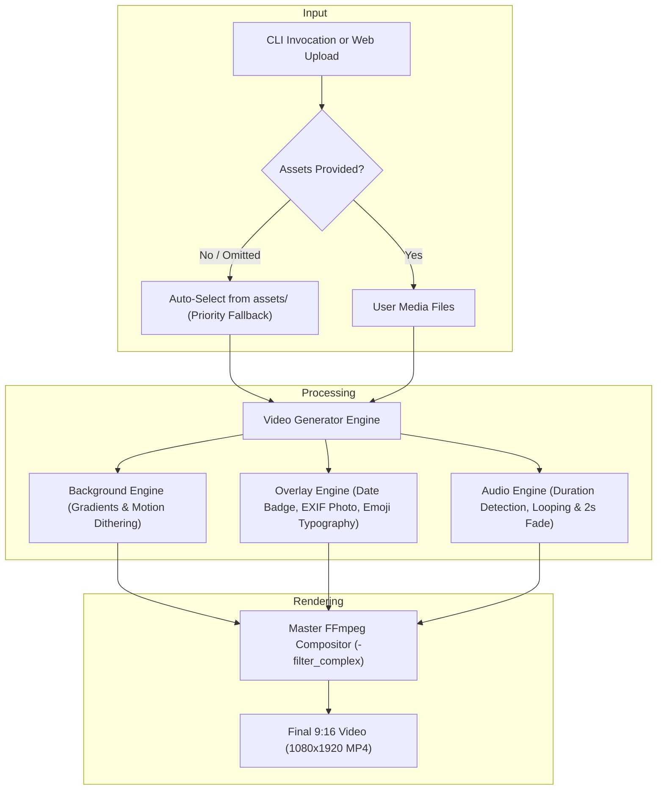

# 🎬 9:16 Portrait Video Generator Studio

[](https://www.python.org/)
[](https://fastapi.tiangolo.com/)
[](https://ffmpeg.org/)
[](https://www.docker.com/)
[](LICENSE)
[](tests/)

A production-ready, high-performance automated studio for generating aesthetic **9:16 portrait videos (1080x1920 @ 30fps)** tailored for TikTok, Instagram Reels, and YouTube Shorts.

Features dual interfaces: an interactive **Web UI Studio** with a live phone preview and a powerful **CLI** built for automated batch rendering pipelines.

---

## 📸 Video Output Specifications

| Metric | Target |
| :--- | :--- |
| **Aspect Ratio** | 9:16 Vertical Portrait |
| **Resolution** | 1080 × 1920 pixels |
| **Frame Rate** | 30.0 fps |
| **Video Codec** | H.264 / AVC (`libx264`, `yuv420p`, CRF 18, `+faststart`) |
| **Audio Codec** | AAC-LC (192 kbps, 44.1 kHz, Stereo) |
| **Typography** | Full Unicode & Color Emojis via Pilmoji |
| **Animation** | Dual live animated looping GIF stickers |

---

## 🏗️ Architecture & Pipeline Flow



---

## ✨ Features

- **Dynamic Curated Gradients**:
  - Palettes: `sunset`, `cyberpunk`, `aurora`, `royal_purple`, `cotton_candy`, `midnight`, `emerald`, `dark_gold`.
  - Modes: `static` (crisp multi-stop gradient) and `animated` (ambient color flow with dithering noise to prevent 8-bit banding).
- **Rich Visual Overlays**:
  - **Dynamic Date Header Badge**: Displays current formatted date or custom text in a frosted pill badge.
  - **Emoji Typography**: Multi-line word-wrapping and font autoscaling with full Apple/Google color emoji support.
  - **Framed Picture**: Drop shadow, rounded corners, and automatic mobile **EXIF rotation** correction (`ImageOps.exif_transpose`).
  - **Animated GIFs**: Seamless looping stickers in single or side-by-side dual sticker layout.
- **Background Music Engine**:
  - Audio duration detection with automatic trimming, looping, and smooth 2-second fade-in/fade-out.
  - Generates warm ambient harmonic synth if no music is provided.
- **Smart Asset Fallback**:
  - If no assets are passed to the CLI, it automatically discovers and chooses assets from the `assets/` directory.
- **Production-Hardened Web API**:
  - Non-blocking async thread-pool offloading for FFmpeg jobs.
  - Concurrency limiter (`asyncio.Semaphore`) to prevent memory exhaustion under concurrent requests.
  - Path traversal protection on `/outputs/{filename}` with strict regex validation.
  - Chunked streaming uploads with 25 MB file size limit and extension validation.
  - Automated disk retention cleanup for expired outputs.
  - Health checks (`GET /health`) and configuration discovery (`GET /api/info`).

---

## 📁 Repository Structure

```
├── assets/                  # Media assets repository
│   ├── demo/                # Bundled sample media (images, GIFs, audio)
│   └── fonts/               # Liberation Sans TTF typography fonts
├── video_generator/         # Core rendering library
│   ├── __init__.py          # Package exports
│   ├── audio.py             # FFmpeg audio trimming, looping, and fade engine
│   ├── config.py            # VideoConfig dataclass & gradient presets
│   ├── engine.py            # Master VideoGenerator orchestrator & FFmpeg compositor
│   ├── gradients.py         # Vectorized NumPy gradient math & dithering
│   ├── overlays.py          # Pillow + Pilmoji visual overlays & typography
│   └── templates.py         # Slot geometries (modern_card, showcase, poster)
├── web/                     # Web UI Studio assets
│   ├── static/              # CSS styles & JavaScript client logic
│   └── templates/           # HTML5 interface with phone mockup
├── tests/                   # Automated pytest suite (24 tests)
│   ├── test_cli.py          # CLI flags, fallback, and validation tests
│   ├── test_generator.py    # Unit & integration rendering tests
│   └── test_server.py       # API route, security, and healthcheck tests
├── cli.py                   # Production CLI tool with smart asset fallback
├── server.py                # Production FastAPI application with lifespan tasks
├── Dockerfile               # Multi-stage production container
├── docker-compose.yml       # 1-command container orchestration
├── pyproject.toml           # Project packaging and dependencies
└── README.md                # Documentation
```

---

## 📦 Prerequisites

1. **Python 3.10+**
2. **FFmpeg & FFprobe**:
   - **Ubuntu/Debian**:
     ```bash
     sudo apt update && sudo apt install -y ffmpeg
     ```
   - **macOS** (Homebrew):
     ```bash
     brew install ffmpeg
     ```
   - **Windows** (winget):
     ```powershell
     winget install Gyan.FFmpeg
     ```

---

## ⚡ Installation

### Option A: Using `uv` (Fastest)
```bash
# Clone the repository
git clone https://github.com/SynonianRaj/static-video-generation-upload-automation.git
cd static-video-generation-upload-automation

# Create virtual environment and install dependencies
uv venv
source .venv/bin/activate  # On Windows: .venv\Scripts\activate
uv pip install -e .
```

### Option B: Using Standard `pip`
```bash
python3 -m venv .venv
source .venv/bin/activate
pip install -e .
```

---

## 🚀 Usage Guide

### 1. Command Line Interface (CLI)

#### Zero-Config Generation
When no assets are specified, the CLI automatically picks images, animated GIFs, and music from the `assets/` folder:
```bash
.venv/bin/python cli.py
```

#### Run Bundled 1-Click Demo
```bash
.venv/bin/python cli.py --demo --output output_demo.mp4
```

#### Custom Video Generation
```bash
.venv/bin/python cli.py \
  --text "Your inspiring quote or announcement 🚀✨" \
  --image path/to/picture.jpg \
  --gif path/to/sticker1.gif \
  --gif2 path/to/sticker2.gif \
  --music path/to/audio.mp3 \
  --gradient aurora \
  --bg-mode animated \
  --duration 20 \
  --output my_custom_video.mp4
```

#### Selective Element Omission
You can explicitly omit specific visual or audio components without using fallbacks:
```bash
.venv/bin/python cli.py --no-image --no-gif2 --output no_picture.mp4
```

#### Complete CLI Options

| Flag | Type | Default | Description |
| :--- | :--- | :--- | :--- |
| `--text` | `str` | Default Hindi quote | Text/quote to display (full emoji support) |
| `--date` | `str` | Current Date | Header pill date text |
| `--image` | `str` | Auto from `assets/` | Path to picture file (`.jpg`, `.png`, `.webp`) |
| `--no-image` | `flag` | `False` | Explicitly disable picture overlay |
| `--gif` | `str` | Auto from `assets/` | Primary animated GIF sticker |
| `--no-gif` | `flag` | `False` | Explicitly disable primary GIF |
| `--gif2` | `str` | Auto from `assets/` | Secondary animated GIF sticker |
| `--no-gif2` | `flag` | `False` | Explicitly disable secondary GIF |
| `--music` | `str` | Auto from `assets/` | Background audio file (`.mp3`, `.mpeg`, `.wav`, etc.) |
| `--no-music` | `flag` | `False` | Disable background audio |
| `--duration`| `float`| `15.0` | Video length in seconds |
| `--gradient`| `choice`| `sunset` | Palette (`sunset`, `cyberpunk`, `aurora`, `royal_purple`, `cotton_candy`, `midnight`, `emerald`, `dark_gold`) |
| `--bg-mode` | `choice`| `static` | Background motion (`static`, `animated`) |
| `--template`| `choice`| `modern_card`| Slot layout (`modern_card`, `showcase`, `poster`) |
| `--card-bg` | `flag` | `False` | Draw frosted dark card behind text |
| `--random-assets` | `flag` | `False` | Randomly pick assets from `assets/` folder |
| `--output`, `-o` | `str` | `output.mp4` | Destination MP4 output path |
| `--verbose`, `-v`| `flag` | `False` | Enable debug logs |
| `--quiet`, `-q`  | `flag` | `False` | Suppress non-error console output |

---

### 2. Interactive Web UI Studio

Launch the FastAPI server:
```bash
.venv/bin/python server.py
```
Open **`http://localhost:8080`** in your browser.

- **Drag-and-Drop Uploads**: Easily drop images, GIFs, and audio files.
- **✨ Load Demo Assets**: Instant 1-click test load of bundled media.
- **Live Phone Preview**: View the generated 9:16 portrait video inside an aesthetic smartphone frame.
- **1-Click Download**: Directly save the rendered MP4 file.

---

## 📡 REST API Reference

### Health Check
```http
GET /health
```
**Response:**
```json
{
  "status": "healthy",
  "version": "1.0.0",
  "uptime_seconds": 128.4,
  "ffmpeg_available": true,
  "ffprobe_available": true,
  "disk_free_gb": 45.8,
  "max_concurrent_renders": 2
}
```

### Server Capabilities & Limits
```http
GET /api/info
```

### Generate Video
```http
POST /api/generate
Content-Type: multipart/form-data
```
**Parameters:**
- `text` *(string, required)*: Text message (max 1000 characters).
- `duration` *(float, default: 20.0)*: Target video length (1.0 to 60.0 seconds).
- `gradient` *(string, default: "sunset")*: Gradient color preset.
- `bg_mode` *(string, default: "static")*: "static" or "animated".
- `template` *(string, default: "modern_card")*: Layout template.
- `image` *(file, optional)*: Image file (max 25 MB).
- `gif` *(file, optional)*: Animated GIF 1 (max 25 MB).
- `gif2` *(file, optional)*: Animated GIF 2 (max 25 MB).
- `music` *(file, optional)*: Audio file (max 25 MB).
- `use_demo` *(string, optional)*: Set to `"true"` to use bundled assets.

**Example `curl` Request:**
```bash
curl -X POST http://localhost:8080/api/generate \
  -F "text=Live your dreams every day ✨🚀" \
  -F "duration=10" \
  -F "gradient=cyberpunk" \
  -F "bg_mode=animated" \
  -F "use_demo=true"
```

---

## 🐳 Docker Deployment

### Docker Compose (Recommended)
```bash
# Build and run in detached mode
docker compose up --build -d

# Check live logs
docker compose logs -f

# Stop container
docker compose down
```

### Docker Directly
```bash
# Build production image
docker build -t portrait-video-studio:latest .

# Run container with volume persistence
docker run -d \
  --name video_studio \
  -p 8080:8080 \
  -v video_outputs:/app/outputs \
  portrait-video-studio:latest
```

---

## ⚙️ Environment Variables

| Variable | Default | Description |
| :--- | :--- | :--- |
| `HOST` | `0.0.0.0` | Server host binding |
| `PORT` | `8080` | Server port |
| `WORKERS` | `1` | Uvicorn worker process count |
| `LOG_LEVEL` | `INFO` | Logging level (`DEBUG`, `INFO`, `WARNING`, `ERROR`) |
| `MAX_DURATION` | `60.0` | Maximum video duration in seconds |
| `MIN_DURATION` | `1.0` | Minimum video duration in seconds |
| `MAX_FILE_SIZE_MB` | `25` | Maximum upload size per file (in megabytes) |
| `MAX_CONCURRENT_RENDERS` | `2` | Max concurrent FFmpeg rendering processes |
| `OUTPUT_RETENTION_MINUTES`| `120` | Output video retention before automatic deletion |
| `CORS_ORIGINS` | `*` | Comma-separated list of allowed CORS origins |

---

## 🧪 Automated Testing

The project includes unit and integration tests covering gradient generation, PIL typography, audio looping, security paths, and API endpoints:
```bash
.venv/bin/python -m pytest -v
```

---

## 📄 License

This project is open-source under the [MIT License](LICENSE).
